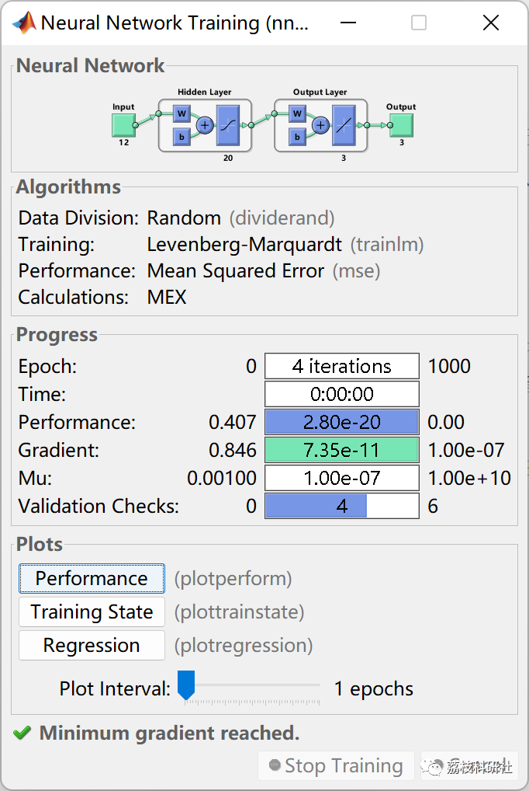
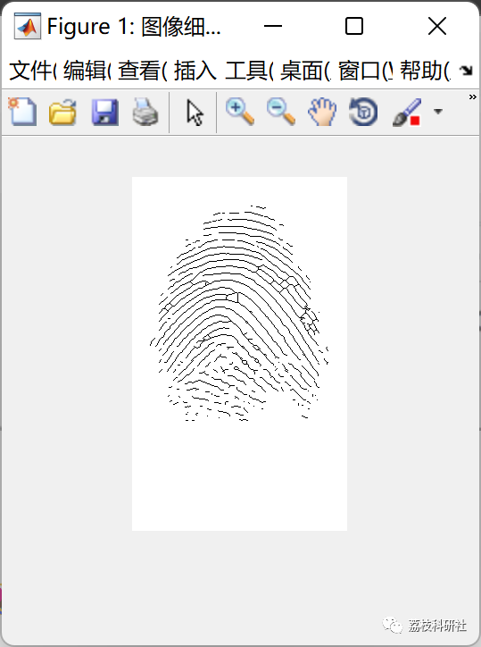
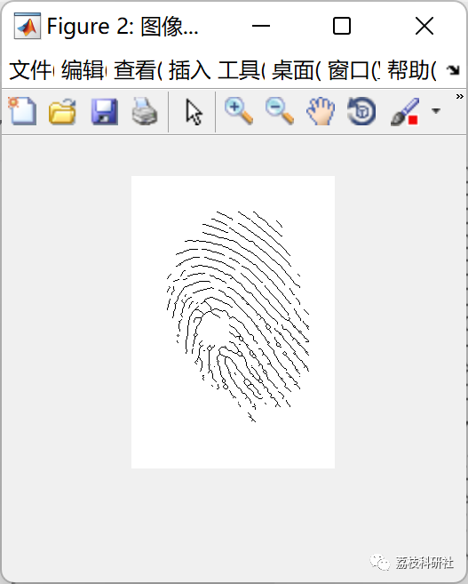
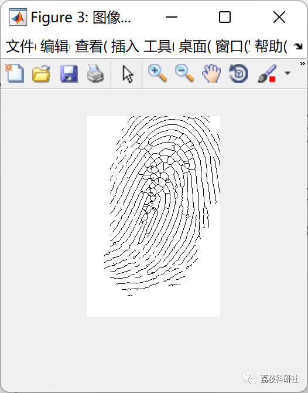
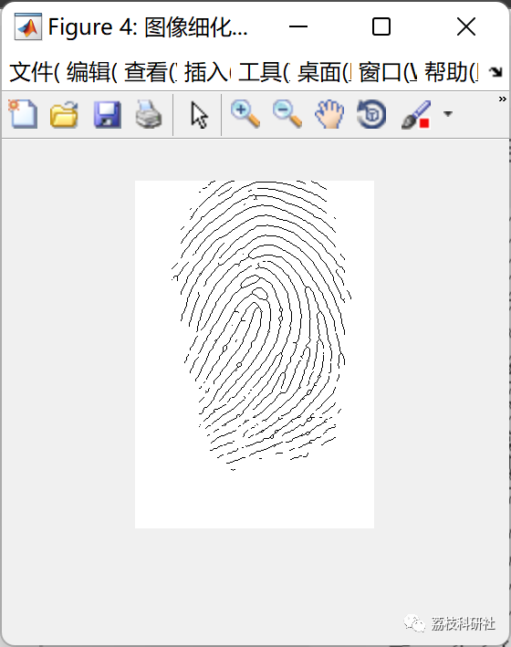
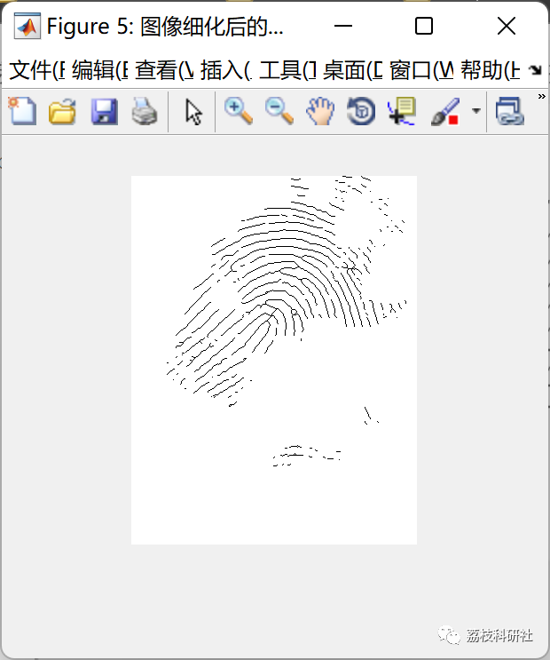
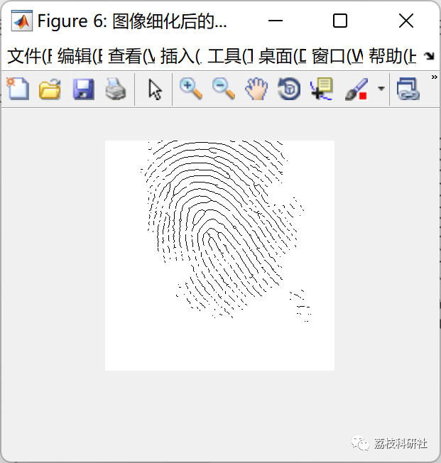
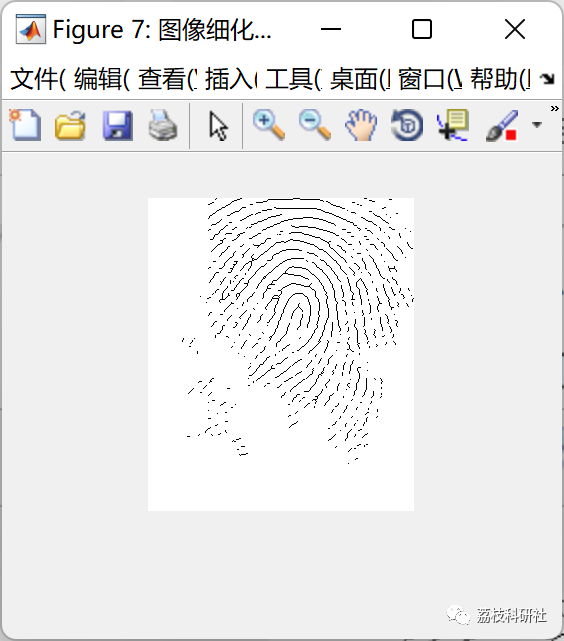
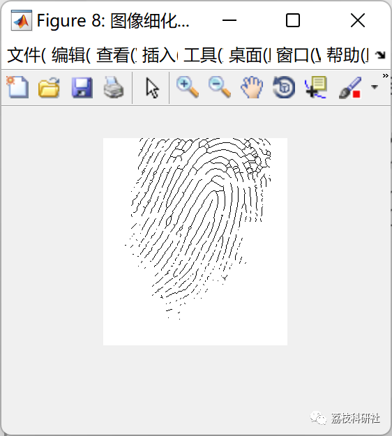

# Fingerprint Recognition Application Based on BP Neural Network Feature Extraction (Matlab Code Implementation)

💥💥💥💞💞💞 Welcome to this blog❤️❤️❤️💥💥💥
🏆 Blog Advantages: 🌞🌞🌞 The content of the blog strives for meticulous thought and clear logic, making it convenient for readers.
⛳️ Mantra: "A journey of a thousand miles is begun with a single step."
Litchi Research Society
Code Collection: Power Systems, Intelligent Algorithms and Applications, Neural Network Prediction, Path Planning, Optimized Scheduling, Workshop Scheduling, Image Processing, Signal Processing...
🎁 Special Section Links: ​
🌈🌈🌈🌟🌟🌟 Electrical Code Intelligent Algorithms and Their Applications Path Planning Neural Network Prediction Optimized Scheduling Image Processing Workshop Scheduling Signal Processing Romantic Her Thoughts Math Modeling Complete Code Matters
💥1 Overview
📚2 Running Results
🎉3 References
🌈4 MATLAB Code Realization
💥1 Overview
Every person (including fingerprints) has unique patterns on their skin, which are different in pattern, breakpoints, and intersection points, meaning they are unique and unchanging throughout life. Relying on this uniqueness and stability, we can match an individual with their fingerprint by comparing their fingerprint to the pre-stored fingerprints. This allows us to verify their true identity. This is the technology of fingerprint recognition.
In ten years, fingerprint recognition technology will enter a leapfrog development golden period. Experts conservatively estimate that within the next five years, China will have a nearly hundred billion market waiting for enterprises to explore. The huge market prospects of fingerprint recognition technology will have a significant impact on both international and domestic security industries. Fingerprint recognition essentially involves extracting the "details" features of a fingerprint. What these "details" refer to is the end points or intersection points of the fingerprint's ridge lines. By studying an enlarged local area of a fingerprint, one can clearly see that at the center of the image, there is a vertically oriented end point of the ridge line, which is a vertical direction detail. Whether the existence, type, location, and direction of details exist is what needs to be extracted as the parameters of the detailed feature.
📚2 Running Results
🎉3 References
[1] Deng Xiuchun, Han Zi, Huang Jian. Application of Fingerprint Recognition Based on BP Neural Network Feature Extraction [J]. Guangxi Light Industry, 2008(04):51-52.
🌈4 MATLAB Code Realization
Click the "Read More" button at the bottom left corner of the article.

## Images

<!-- PAYMENT_BLOCK -->

## Get this dataset

- Payment link (Stripe): [Buy now](https://buy.stripe.com/3cs8yP7sY87d0vu9AB)
- Payment QR code: 

<!-- /PAYMENT_BLOCK -->
